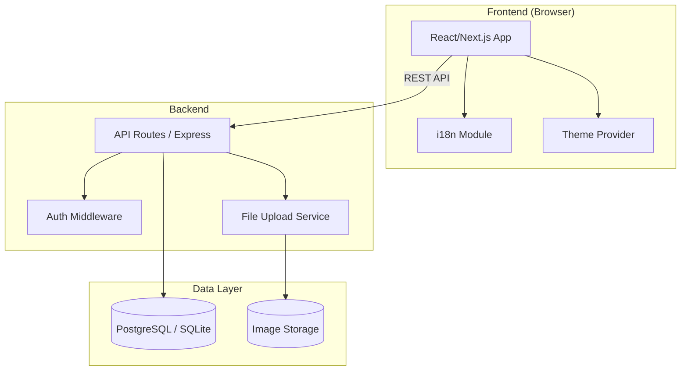
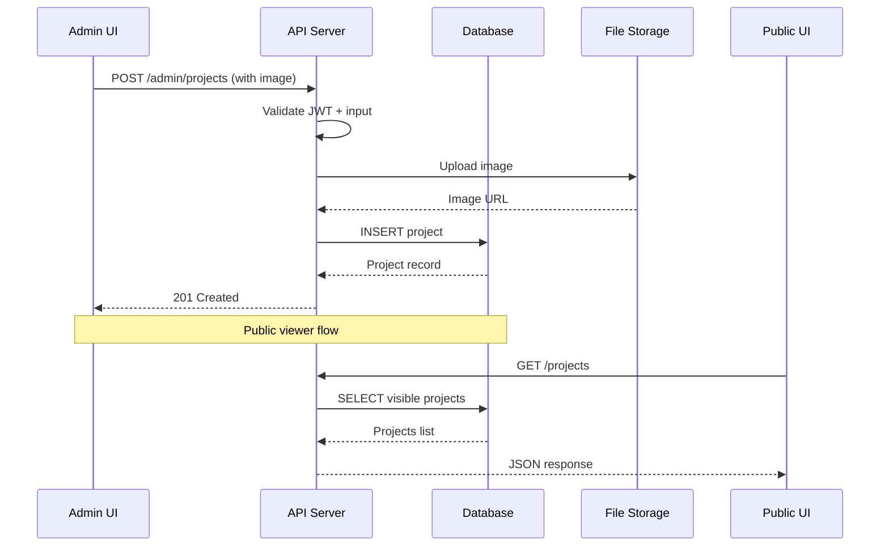

# PRD — אתר תיק עבודות אישי

**מסמך:** Product Requirements Document (PRD)  
**גרסה:** 1.0  
**תאריך:** 8 ביוני 2026  
**סטטוס:** טיוטה לאישור  
**בעלים:** מפתח התוכנה (בעל האתר)

---

## 1. Executive Summary — סיכום מנהלים

### 1.1 תיאור המוצר

אתר תיק עבודות אישי ופרטי המיועד למפתח תוכנה להצגת פרויקטי פיתוח frontend (עם תמיכת backend בסיסית). האתר משמש ככלי תצוגה מקצועי — לא כפלטפורמה ציבורית — ומאפשר שיתוף נקודתי עם מעסיקים פוטנציאליים, עמיתים מקצועיים ומגייסים.

### 1.2 בעיה ופתרון

| בעיה | פתרון |
|------|--------|
| פרויקטים מפוזרים בין GitHub, README וקישורים | מרכז תצוגה אחד עם מידע מובנה |
| עדכון תוכן דורש שינוי קוד | פאנל ניהול (Admin) לעריכה ללא קוד |
| חוסר התאמה לשפות ומצבי תצוגה | תמיכה בעברית/אנגלית + Dark/Light mode |
| קושי בסינון פרויקטים לפי טכנולוגיה | מערכת תגיות וסינון |

### 1.3 עקרונות מנחים

1. **פשטות** — ממשק נקי, ללא עומס ויזואלי
2. **מקצועיות** — עיצוב עדין, ללא אימוג'ים או אלמנטים "צעקניים"
3. **ניתנות למימוש** — מתאים לצוות של מפתח יחיד
4. **ביצועים** — טעינה מהירה, תמונות מאופטמות
5. **אבטחה** — גם אתר "פרטי" דורש הגנה על פאנל הניהול

### 1.4 היקף (Scope)

**בהיקף (In Scope):**
- דף בית + גaleria פרויקטים + דף פרויקט בודד
- פאנל Admin: CRUD לפרויקטים
- רב-לשוניות (עברית/אנגלית)
- Dark/Light mode
- סינון לפי תגיות
- רספונסיביות ונגישות בסיסית

**מחוץ להיקף (Out of Scope — v1):**
- הרשמה/משתמשים מרובים
- בלוג / מאמרים
- Analytics מתקדם
- תגובות / צ'אט
- פרסום ציבורי / SEO אגרסיבי

---

## 2. Goals & Objectives — מטרות ויעדים

### 2.1 מטרות עסקיות

| # | מטרה | מדד הצלחה |
|---|------|-----------|
| G1 | הצגה מקצועית של פרויקטים | ≥ 5 פרויקטים מוצגים עם מידע מלא |
| G2 | עדכון תוכן מהיר | הוספת פרויקט חדש תוך < 5 דקות |
| G3 | חוויית צפייה נעימה | Lighthouse Performance ≥ 90 |
| G4 | נגישות לקהלים שונים | תמיכה בעברית (RTL) ואנגלית (LTR) |

### 2.2 מטרות טכניות

- **T1:** ארכיטקטורה המאפשרת הרחבה עתידית (API, DB)
- **T2:** זמן טעינה ראשוני < 2 שניות (3G)
- **T3:** Core Web Vitals בירוק (LCP, CLS, INP)
- **T4:** אבטחת פאנל Admin עם אימות

### 2.3 קהל יעד

| Persona | תיאור | צרכים עיקריים |
|---------|--------|----------------|
| **P1 — בעל האתר** | מפתח Full-stack / Frontend | ניהול תוכן קל, עדכון פרויקטים, שליטה בעיצוב |
| **P2 — מעסיק / מגייס** | HR, Tech Lead, Hiring Manager | סקירה מהירה של פרויקטים, קישור ל-GitHub, הבנת טכנולוגיות |
| **P3 — עמית מקצועי** | מפתחים אחרים | השראה, קוד פתוח, הבנת stack |
| **P4 — מentor / מרצה** | בודק תיק עבודות | תמונה כוללת של יכולות ופרויקטים |

---

## 3. User Stories — סיפורי משתמש

### 3.1 בעל האתר (Admin)

| ID | סיפור | קriterion קבלה | עדיפות |
|----|--------|----------------|--------|
| US-01 | כבעל האתר, אני רוצה להוסיף פרויקט חדש דרך פאנל ניהול, כדי שלא אצטרך לערוך קוד | טופס עם שדות חובה, שמירה מוצלחת, הפרויקט מופיע באתר | Must |
| US-02 | כבעל האתר, אני רוצה לערוך פרויקט קיים, כדי לעדכן תיאור או תמונה | טעינת נתונים קיימים, שמירה, עדכון מיידי בתצוגה | Must |
| US-03 | כבעל האתר, אני רוצה למחוק פרויקט, כדי להסיר פרויקטים לא רלוונטיים | אישור מחיקה, הסרה מה-DB ומהתצוגה | Must |
| US-04 | כבעל האתר, אני רוצה להעלות תמונת כותרת, כדי להציג את הפרויקט ויזואלית | העלאה, preview, דחיסה אוטומטית | Must |
| US-05 | כבעל האתר, אני רוצה להוסיף תגיות לפרויקט, כדי לסווג לפי טכנולוגיה | בחירה/יצירת תגיות, שמירה, הצגה בכרטיס | Must |
| US-06 | כבעל האתר, אני רוצה להתחבר לפאנל Admin בצורה מאובטחת | Login עם credentials, session/token, logout | Must |
| US-07 | כבעל האתר, אני רוצה לשנות סדר תצוגת פרויקטים | Drag & drop או שדה order | Should |
| US-08 | כבעל האתר, אני רוצה לסמן פרויקט כ"מוצג" / "מוסתר" | Toggle visibility ללא מחיקה | Should |

### 3.2 מבקר (Viewer)

| ID | סיפור | קriterion קבלה | עדיפות |
|----|--------|----------------|--------|
| US-10 | כמבקר, אני רוצה לראות רשימת פרויקטים בדף הבית, כדי להבין במה עסק המפתח | Grid/List של כרטיסי פרויקט | Must |
| US-11 | כמבקר, אני רוצה ללחוץ על פרויקט ולראות פרטים מלאים | דף פרויקט: תמונה, תיאור, תגיות, קישור GitHub | Must |
| US-12 | כמבקר, אני רוצה לסנן פרויקטים לפי תגית, כדי למצוא פרויקטים ב-React למשל | סינון דינמי, URL query param | Must |
| US-13 | כמבקר, אני רוצה לעבור בין עברית לאנגלית | Toggle שפה, שמירה ב-localStorage, RTL/LTR | Must |
| US-14 | כמבקר, אני רוצה לעבור בין מצב כהה לבהיר | Toggle theme, שמירה ב-localStorage | Must |
| US-15 | כמבקר, אני רוצה שהאתר יעבוד טוב בנייד | Breakpoints: mobile, tablet, desktop | Must |
| US-16 | כמבקר, אני רוצה לפתוח קישור GitHub בטאב חדש | קישור חיצוני עם `rel="noopener noreferrer"` | Must |

### 3.3 Edge Cases

| תרחיש | התנהגות צפויה |
|--------|----------------|
| אין פרויקטים | Empty state עם הודעה מתאימה |
| תמונה לא נטענת | Placeholder + alt text |
| GitHub link חסר | כפתור מוסתר / disabled |
| שפה לא נתמכת | Fallback לאנגלית |
| גישה ל-Admin ללא auth | Redirect ל-login |

---

## 4. Technical Requirements — דרישות טכניות

### 4.1 מודל נתונים — פרויקט

| שדה | סוג | חובה | תיאור |
|-----|-----|------|--------|
| `id` | UUID | כן | מזהה ייחודי |
| `title` | i18n object `{ he, en }` | כן | כותרת בשתי שפות |
| `description` | i18n object `{ he, en }` | כן | תיאור (Markdown אופציונלי) |
| `coverImage` | URL / path | כן | תמונת כותרת |
| `githubUrl` | URL | לא | קישור ל-repository |
| `liveUrl` | URL | לא | קישור לדemo חי |
| `tags` | string[] | לא | תגיות (React, Node.js, TypeScript...) |
| `featured` | boolean | לא | פרויקט מודגש בדף הבית |
| `order` | number | לא | סדר תצוגה |
| `visible` | boolean | כן | מוצג / מוסתר |
| `createdAt` | datetime | כן | תאריך יצירה |
| `updatedAt` | datetime | כן | תאריך עדכון אחרון |

**שדות מומלצים נוספים (Should):**

| שדה | תיאור |
|-----|--------|
| `shortDescription` | תקציר לכרטיס (מקסימום 160 תווים) |
| `role` | תפקיד בפרויקט (Lead, Solo, Contributor) |
| `year` | שנת הפרויקט |
| `status` | `completed` / `in-progress` / `archived` |

### 4.2 API Endpoints (Backend)

| Method | Endpoint | תיאור | Auth |
|--------|----------|--------|------|
| GET | `/api/projects` | רשימת פרויקטים (visible only) | לא |
| GET | `/api/projects/:id` | פרויקט בודד | לא |
| GET | `/api/tags` | רשימת תגיות | לא |
| POST | `/api/admin/login` | התחברות | לא |
| POST | `/api/admin/logout` | התנתקות | כן |
| GET | `/api/admin/projects` | כל הפרויקטים (כולל hidden) | כן |
| POST | `/api/admin/projects` | יצירת פרויקט | כן |
| PUT | `/api/admin/projects/:id` | עדכון פרויקט | כן |
| DELETE | `/api/admin/projects/:id` | מחיקת פרויקט | כן |
| POST | `/api/admin/upload` | העלאת תמונה | כן |

### 4.3 דרישות Frontend

| דרישה | פירוט |
|--------|--------|
| Framework | React / Next.js (מומלץ) או Vue / Nuxt |
| Styling | Tailwind CSS / CSS Modules |
| i18n | react-i18next / next-intl |
| State | React Query / SWR לנתונים, Context/Zustand ל-UI |
| Routing | App Router (Next.js) או React Router |
| Forms | React Hook Form + Zod validation |
| Images | next/image / lazy loading + WebP |

### 4.4 דרישות Backend

| דרישה | פירוט |
|--------|--------|
| Runtime | Node.js (Express / Fastify) או Next.js API Routes |
| Database | SQLite (dev) / PostgreSQL (prod) — Prisma ORM |
| Auth | JWT ב-httpOnly cookie או session |
| File Storage | Local / Cloudinary / S3 |
| Validation | Zod / Joi |

### 4.5 דרישות ביצועים

| מדד | יעד |
|-----|-----|
| First Contentful Paint | < 1.5s |
| Largest Contentful Paint | < 2.5s |
| Cumulative Layout Shift | < 0.1 |
| Bundle size (initial) | < 200KB gzipped |
| Image optimization | WebP, responsive sizes, lazy load |

### 4.6 דרישות אבטחה

> **קריטי:** גם אתר "פרטי" חשוף לאינטרנט — פאנל Admin חייב להיות מוגן.

| דרישה | יישום |
|--------|--------|
| Authentication | Username/password + bcrypt hash |
| Session | JWT httpOnly cookie, expiry 24h |
| Rate limiting | Login: max 5 attempts / 15 min |
| CSRF | Token על POST/PUT/DELETE |
| Input validation | Sanitize כל input, validate URLs |
| File upload | MIME whitelist (jpg, png, webp), max 2MB |
| HTTPS | חובה ב-production |
| Environment vars | Secrets ב-.env, לא ב-repo |
| CORS | Restricted origins |
| Headers | Helmet.js / security headers |
| Admin route | `/admin/*` — middleware auth |

### 4.7 דרישות נגישות (WCAG 2.1 Level A)

- ניגודיות צבעים מינימלית 4.5:1
- ניווט מקלדת מלא (Tab, Enter, Escape)
- `alt` text לכל תמונה
- `aria-label` לכפתורים אייקון
- Focus visible
- Semantic HTML (`header`, `main`, `nav`, `article`)
- Skip to content link

---

## 5. UI/UX Specifications — מפרט עיצוב וחוויית משתמש

### 5.1 עקרונות עיצוב

| עקרון | יישום |
|--------|--------|
| מינימализם | הרבה whitespace, typography ברור |
| היררכיה | כותרות בולטות, תיאורים משניים |
| עקביות | Design tokens אחידים (spacing, radius, colors) |
| לא צעקני | צבע accent אחד, ללא gradients אגרסיביים |
| מקצועי | ללא אימוג'ים ב-UI |

### 5.2 Design Tokens (המלצה)

**Light Mode:**
```
Background:    #FAFAFA
Surface:       #FFFFFF
Text Primary:  #1A1A1A
Text Secondary:#6B7280
Accent:        #2563EB (כחול עדין)
Border:        #E5E7EB
```

**Dark Mode:**
```
Background:    #0F0F0F
Surface:       #1A1A1A
Text Primary:  #F5F5F5
Text Secondary:#9CA3AF
Accent:        #3B82F6
Border:        #2D2D2D
```

**Typography:**
```
Headings:  Inter / Heebo (עברית)
Body:      Inter / Heebo
Code/Tags: JetBrains Mono
```

### 5.3 Wireframes מילוליים

#### 5.3.1 דף הבית (Home)

```
┌─────────────────────────────────────────────────────────┐
│  [Logo/Name]              [HE|EN]  [Dark/Light]         │
├─────────────────────────────────────────────────────────┤
│                                                         │
│              שלום, אני [שם]                             │
│         מפתח Frontend | Full-stack Developer            │
│                                                         │
│         [קצר bio — 2-3 שורות]                           │
│         [GitHub] [LinkedIn] [Email]                     │
│                                                         │
├─────────────────────────────────────────────────────────┤
│  פרויקטים                          [All] [React] [Node] │
│                                                         │
│  ┌──────────┐  ┌──────────┐  ┌──────────┐              │
│  │ [Image]  │  │ [Image]  │  │ [Image]  │              │
│  │ Title    │  │ Title    │  │ Title    │              │
│  │ Tags...  │  │ Tags...  │  │ Tags...  │              │
│  └──────────┘  └──────────┘  └──────────┘              │
│                                                         │
│  ┌──────────┐  ┌──────────┐                            │
│  │ [Image]  │  │ [Image]  │                            │
│  │ Title    │  │ Title    │                            │
│  └──────────┘  └──────────┘                            │
│                                                         │
├─────────────────────────────────────────────────────────┤
│  Footer: © 2026 | Built with [stack]                    │
└─────────────────────────────────────────────────────────┘
```

#### 5.3.2 דף פרויקט בודד

```
┌─────────────────────────────────────────────────────────┐
│  [← חזרה לפרויקטים]        [HE|EN]  [Dark/Light]        │
├─────────────────────────────────────────────────────────┤
│                                                         │
│  ┌─────────────────────────────────────────────────┐   │
│  │              [Cover Image — Full Width]          │   │
│  └─────────────────────────────────────────────────┘   │
│                                                         │
│  Project Title                                          │
│  [React] [TypeScript] [Node.js]                         │
│                                                         │
│  [View on GitHub]  [Live Demo]                          │
│                                                         │
│  ─────────────────────────────────────────────          │
│                                                         │
│  ## תיאור הפרויקט                                       │
│  פסקאות תיאור מפורט...                                  │
│                                                         │
│  ## טכנולוגיות                                          │
│  רשימת טכנולוגיות / תגיות                               │
│                                                         │
└─────────────────────────────────────────────────────────┘
```

#### 5.3.3 פאנל Admin — רשימת פרויקטים

```
┌─────────────────────────────────────────────────────────┐
│  Admin Panel                              [Logout]      │
├─────────────────────────────────────────────────────────┤
│  Projects                          [+ Add New Project]  │
│                                                         │
│  ┌─────────────────────────────────────────────────┐   │
│  │ [thumb] Project A    [Visible]  [Edit] [Delete] │   │
│  │ [thumb] Project B    [Hidden]   [Edit] [Delete] │   │
│  │ [thumb] Project C    [Visible]  [Edit] [Delete] │   │
│  └─────────────────────────────────────────────────┘   │
└─────────────────────────────────────────────────────────┘
```

#### 5.3.4 פאנל Admin — טופס פרויקט

```
┌─────────────────────────────────────────────────────────┐
│  ← Back to Projects                                     │
├─────────────────────────────────────────────────────────┤
│  Add / Edit Project                                     │
│                                                         │
│  Title (Hebrew):    [________________________]          │
│  Title (English):   [________________________]          │
│                                                         │
│  Description (HE):  [                          ]        │
│                     [                          ]        │
│  Description (EN):  [                          ]        │
│                     [                          ]        │
│                                                         │
│  Cover Image:       [Upload] [Preview]                │
│  GitHub URL:        [https://github.com/...]            │
│  Live Demo URL:     [https://...]                       │
│                                                         │
│  Tags:              [React] [x] [TypeScript] [x] [+ Add]│
│                                                         │
│  [ ] Featured    [x] Visible                          │
│  Order:             [3]                                 │
│                                                         │
│              [Cancel]  [Save Project]                   │
└─────────────────────────────────────────────────────────┘
```

#### 5.3.5 Login

```
┌─────────────────────────────────────────────────────────┐
│                                                         │
│              Admin Login                                │
│                                                         │
│         Username:  [________________]                   │
│         Password:  [________________]                   │
│                                                         │
│              [Login]                                    │
│                                                         │
└─────────────────────────────────────────────────────────┘
```

### 5.4 Breakpoints

| שם | רוחב | Layout |
|----|------|--------|
| Mobile | < 640px | 1 column, hamburger nav |
| Tablet | 640–1024px | 2 columns grid |
| Desktop | > 1024px | 3 columns grid, full nav |

### 5.5 מצבי UI

| מצב | התנהגות |
|-----|---------|
| Loading | Skeleton cards |
| Empty | Illustration + "אין פרויקטים עדיין" |
| Error | Toast notification + retry |
| Success | Toast "נשמר בהצלחה" |

### 5.6 אנימציות

- מעבר עדין בין Dark/Light (transition 200ms)
- Hover על כרטיס פרויקט: scale 1.02 + shadow
- Page transitions: fade 150ms
- **לא:** parallax, particles, scroll hijacking

---

## 6. Architecture Overview — סקירת ארכיטקטורה

### 6.1 דיאגרמת ארכיטקטורה



### 6.2 מבנה תיקיות (מומלץ)

```
portfolio/
├── src/
│   ├── app/                    # Next.js App Router
│   │   ├── page.tsx            # Home
│   │   ├── projects/[id]/      # Project detail
│   │   ├── admin/              # Admin panel
│   │   └── api/                # API routes
│   ├── components/
│   │   ├── ui/                 # Button, Input, Card...
│   │   ├── layout/             # Header, Footer, Nav
│   │   └── projects/           # ProjectCard, ProjectGrid
│   ├── lib/
│   │   ├── api.ts              # API client
│   │   ├── auth.ts             # Auth helpers
│   │   └── db.ts               # Prisma client
│   ├── hooks/                  # useTheme, useLanguage
│   ├── i18n/                   # he.json, en.json
│   └── types/                  # TypeScript types
├── prisma/
│   └── schema.prisma
├── public/
│   └── uploads/                # Local images (dev)
└── .env
```

### 6.3 Stack מומלץ (מפתח יחיד)

| שכבה | טכנולוגיה | נימוק |
|------|-----------|--------|
| Frontend | Next.js 14+ (App Router) | SSR, API routes, i18n |
| Styling | Tailwind CSS | מהיר, responsive |
| Backend | Next.js API Routes | monorepo פשוט |
| ORM | Prisma | type-safe, migrations |
| DB | SQLite → PostgreSQL | קל להתחלה, scalable |
| Auth | NextAuth / custom JWT | פשוט למפתח יחיד |
| Hosting | Vercel + Supabase / Railway | free tier, CI/CD |
| Images | Cloudinary / Vercel Blob | CDN, optimization |

### 6.4 זרימת נתונים — CRUD פרויקט



---

## 7. Development Timeline — לוח זמנים פיתוח

### 7.1 פירוק לפазы

| Phase | תיאור | משך | תלות |
|-------|--------|-----|------|
| **P0** | Setup + Infrastructure | 2–3 ימים | — |
| **P1** | Public UI (Home + Projects) | 4–5 ימים | P0 |
| **P2** | Project Detail + Filtering | 2–3 ימים | P1 |
| **P3** | i18n + Theme Toggle | 2 ימים | P1 |
| **P4** | Backend API + Database | 3–4 ימים | P0 |
| **P5** | Admin Panel (CRUD) | 4–5 ימים | P4 |
| **P6** | Auth + Security | 2 ימים | P5 |
| **P7** | Polish, A11y, Performance | 2–3 ימים | All |
| **P8** | Deploy + Testing | 1–2 ימים | All |

**סה"כ משוער: 22–27 ימי עבודה (~4–5 שבועות, מפתח יחיד, part-time)**

### 7.2 Gantt (טקסטואלי)

```
Week 1:  [P0 Setup========][P1 Public UI================]
Week 2:  [P1 cont.====][P2 Detail][P3 i18n/Theme][P4 Backend==]
Week 3:  [P4 cont.====][P5 Admin Panel========================]
Week 4:  [P5 cont.====][P6 Auth====][P7 Polish==============]
Week 5:  [P7 cont.==][P8 Deploy==]  Buffer / fixes
```

### 7.3 Milestones

| Milestone | תאריך יעד | Deliverable |
|-----------|-----------|-------------|
| M1 — MVP Static | שבוע 1 | דף בית עם mock data |
| M2 — Dynamic | שבוע 2 | פרויקטים מ-API, סינון |
| M3 — Admin Ready | שבוע 3 | CRUD מלא + auth |
| M4 — Production | שבוע 4–5 | Deploy, optimized |

---

## 8. Success Metrics — מדדי הצלחה

### 8.1 מדדים כמותיים

| מדד | יעד | כלי מדידה |
|-----|-----|-----------|
| Lighthouse Performance | ≥ 90 | Chrome DevTools |
| Lighthouse Accessibility | ≥ 90 | Chrome DevTools |
| Lighthouse Best Practices | ≥ 95 | Chrome DevTools |
| Time to add project | < 5 min | Manual test |
| Mobile usability | Pass | Google Mobile-Friendly |
| Uptime | ≥ 99% | Hosting monitor |

### 8.2 מדדים איכותיים

| מדד | קriterion |
|-----|-----------|
| עיצוב מקצועי | משוב חיובי מ-2+ עמיתים |
| קלות שימוש Admin | הוספת פרויקט ללא תיעוד |
| RTL תקין | עברית מוצגת נכון בכל המסכים |
| Dark mode | קריאות טובה בשני המצבים |

### 8.3 Definition of Done (DoD)

פרויקט נחשב **הושלם** כאשר:

- [ ] כל User Stories עם עדיפות Must מיושמות
- [ ] Admin panel מאובטח ופועל
- [ ] רספונסיבי ב-mobile, tablet, desktop
- [ ] עברית + אנגלית + RTL/LTR
- [ ] Dark/Light mode
- [ ] Lighthouse scores ≥ יעדים
- [ ] Deployed ל-production עם HTTPS
- [ ] README עם הוראות setup

---

## 9. הערכת עלויות — זמן פיתוח

### 9.1 breakdown לפי תפקיד (מפתח יחיד = Full-stack)

| משימה | שעות | % |
|--------|------|---|
| Setup, config, CI/CD | 16 | 8% |
| UI Components + Layout | 32 | 16% |
| Public pages (Home, Detail) | 24 | 12% |
| i18n + Theme system | 16 | 8% |
| Backend API + DB schema | 24 | 12% |
| Admin CRUD + Upload | 32 | 16% |
| Authentication + Security | 16 | 8% |
| Testing + Bug fixes | 16 | 8% |
| Performance + A11y | 12 | 6% |
| Deploy + Documentation | 12 | 6% |
| **סה"כ** | **~200 שעות** | **100%** |

### 9.2 עלויות תשתית (חודשי)

| שירות | עלות | הערות |
|--------|------|--------|
| Vercel (Hobby) | $0 | Free tier |
| Supabase / Railway DB | $0–5 | Free tier / minimal |
| Cloudinary | $0 | Free tier (25 credits) |
| Domain (optional) | ~$12/שנה | לא חובה לאתר פרטי |
| **סה"כ** | **$0–5/חודש** | |

---

## 10. סיכונים ומיטיגציה

| סיכון | הסתברות | השפעה | מיטיגציה |
|--------|---------|--------|-----------|
| Scope creep | גבוהה | בינונית | הקפדה על Out of Scope |
| Over-engineering | בינונית | גבוהה | MVP first, iterate |
| Auth vulnerabilities | נמוכה | גבוהה | JWT httpOnly, rate limit |
| Image performance | בינונית | בינונית | CDN + WebP + lazy load |
| RTL bugs | בינונית | בינונית | בדיקות early עם עברית |

---

## 11. נספחים

### 11.1 רשימת תגיות מומלצות (Seed Data)

```
Frontend:  React, Vue, Next.js, TypeScript, Tailwind CSS, HTML/CSS
Backend:   Node.js, Express, Python, FastAPI
Database:  PostgreSQL, MongoDB, SQLite, Prisma
Tools:     Git, Docker, Vercel, AWS
Other:     REST API, GraphQL, WebSocket, PWA
```

### 11.2 Checklist לפני Deploy

- [ ] `.env` לא ב-git
- [ ] Admin password hashed
- [ ] HTTPS enabled
- [ ] Rate limiting on login
- [ ] Image upload validated
- [ ] Error pages (404, 500)
- [ ] robots.txt — `Disallow: /admin`
- [ ] Meta tags בסיסיים

---

**סוף המסמך**
